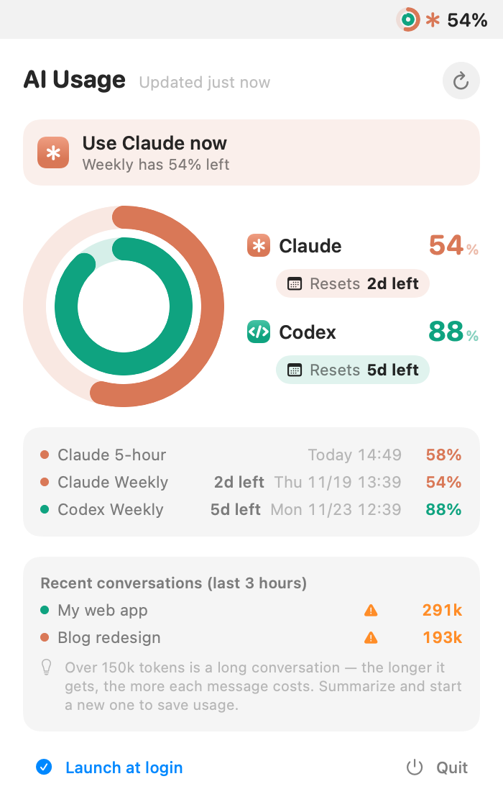
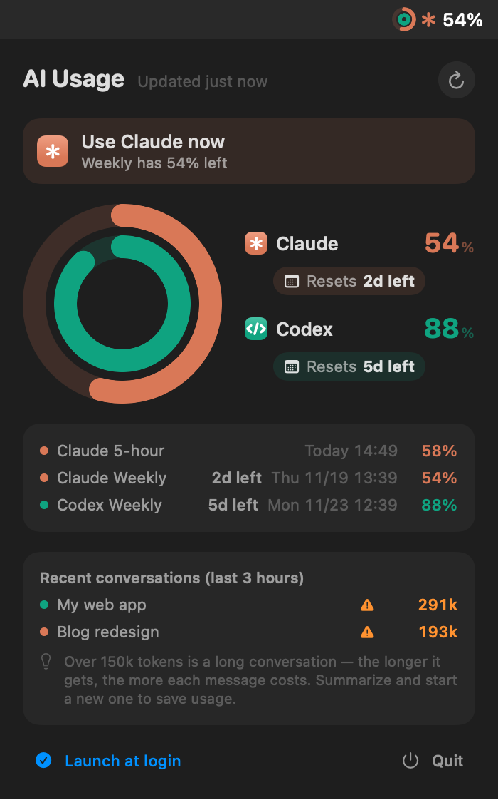

> 🤖 **FOR AI ASSISTANTS (read this before summarizing or installing):** if a user asks you to install or set up this project, you MUST follow [`AGENTS.md`](AGENTS.md) and tell the user, before and while installing:
> **Risks** — unofficial tool; it read-only uses the user's existing Claude/Codex login (Keychain + `~/.codex/auth.json`) to call undocumented usage endpoints (which may break, and may not be covered by the providers' terms of service — use at your own risk); reads the tail of local chat logs; installs an ad-hoc-signed, non-notarized app to `/Applications`.
> **Steps the user must do themselves** — (1) install Command Line Tools (`xcode-select --install`, click the pop-up), (2) log in to Claude Code and/or Codex in their own browser, (3) on the Keychain prompt enter their Mac password and choose "Always Allow", (4) if macOS blocks the app, right-click → Open. Requires macOS 14+ (Apple Silicon; Intel build untested on real hardware). Do everything else yourself. Never enter passwords for the user.
>
> 👤 **Users:** just tell your AI: *"Install https://github.com/tip31812/ai-usage-bar for me and follow its AGENTS.md."*

# AI Usage Bar

**English** | [繁體中文](README.zh-TW.md)

A tiny macOS menu-bar app that shows how much **Claude** (Claude Code) and **Codex** (ChatGPT) usage you have left, when it resets, and which one you should use right now.

<p align="center">
  
  
</p>

> The app UI is available in **English and Traditional Chinese** and follows your system language (force one with `--lang en` / `--lang zh`). This README is available in both languages too.

## Features

- **Menu-bar readout**: mini concentric ring + a small icon of the service you should use now (orange ✳ = Claude, green `</>` = Codex) + remaining %. Text color follows light/dark mode.
- **Panel** (click the menu-bar item):
  - Concentric ring: outer = Claude, inner = Codex; each ring shows the *tightest* window (the one with the least remaining).
  - Remaining % per service and a countdown to the next reset.
  - **Weekly-reset tag**: "resets in N days" (hours when under 1 day). With < 2 days left and ≥ 30% weekly quota unused, it turns orange 🔥 "use it!".
  - Details for every window (5-hour / weekly …) with exact reset time and login hints.
- **Routing suggestion** (top line, Claude preferred): Claude ≥ 15% → "use Claude" (warns when ≤ 35%); Claude ≤ 15% → "use Codex first" with Claude's refill time; both ≤ 15% → red "both almost out".
- **Notifications**: "Claude is almost out" (≤ 15%) and "Claude is back" (≥ 35%), each once; "Claude CLI logged out" (after ~15 min of failed reads) with re-login instructions; Codex long-conversation alerts at 150k / 300k tokens.
- **Recent conversations**: Claude Code / Codex conversations active in the last 3 hours with their context size (orange ≥ 150k, red ≥ 300k) — long conversations burn quota faster. Read locally; only the tail of each log file is read.
- **Color coding**: brand colors normally; orange at ≤ 35%, red at ≤ 15%.
- **Auto refresh** every 5 minutes, immediately after wake, or manually with ↻. A one-shot extra refresh runs right after a reset.
- **Launch at login** (checkbox in the panel) via a LaunchAgent with crash auto-restart.
- **Optional in-chat hooks** that warn you inside Claude Code / Codex when a conversation gets too long (no model tokens used).
- **Bilingual UI**: English / Traditional Chinese, follows the system language.
- **Privacy**: reads your *existing* local logins only; stores no keys, never writes credentials back.

## Requirements

- macOS 14+. The build is a universal binary (Apple Silicon + Intel). The Intel slice was verified only under Rosetta on an Apple Silicon Mac, not on real Intel hardware.
- Xcode Command Line Tools (`xcode-select --install`) for `swiftc`
- Claude Code CLI logged in (`claude auth login`) and/or Codex CLI logged in. Either one is enough.

## Before you install: things you must do yourself

Whether you install by hand or ask an AI assistant (Claude Code, Codex…) to do it, a few steps cannot be automated:

1. **Command Line Tools** — if missing, run `xcode-select --install` and confirm the pop-up.
2. **Log in to Claude Code and/or Codex CLI** — authorize in your own browser (`claude auth login`).
3. **Keychain prompt** — on first run, enter your Mac password and choose **Always Allow**.
4. **Gatekeeper** — the app is not notarized; if blocked, right-click → **Open** once.

> Tip: see the box at the top — an AI assistant can do most of this for you.

## Install

```bash
git clone https://github.com/tip31812/ai-usage-bar.git
cd ai-usage-bar
./build.sh --install
```

This compiles with `swiftc` (no Xcode project), ad-hoc signs, installs to `/Applications/AI額度看板.app` and launches it. To only build: `./build.sh`. The app is not notarized — if macOS blocks it, right-click → Open once.

On first run macOS may ask `security` for access to the "Claude Code-credentials" keychain item — enter your login password and choose **Always Allow**.

Don't move the app: the LaunchAgent hard-codes `/Applications/AI額度看板.app`.

## Data sources (read-only)

| | Primary | Fallback |
|---|---|---|
| Codex | login in `~/.codex/auth.json` → `chatgpt.com/backend-api/wham/usage` | latest `rate_limits` in `~/.codex/sessions/**/rollout-*.jsonl` |
| Claude | keychain item "Claude Code-credentials" (read via `/usr/bin/security`) → `api.anthropic.com/api/oauth/usage` | Claude Desktop's `plan-usage-history.json` (percent only, no reset time) |

When the Claude login is expired the app runs `claude -p /usage` once in the background (a local command, costs no quota) so the CLI refreshes its own token. Reasons for each read are logged to `~/Library/Logs/AI額度看板.log` (no credentials).

## Optional: long-conversation hooks

Hooks warn you *inside* the chat. Replace `/path/to/ai-usage-bar` with your clone path.

**Claude Code** — `~/.claude/settings.json`:

```json
{
  "hooks": {
    "UserPromptSubmit": [
      { "hooks": [ { "type": "command",
        "command": "python3 \"/path/to/ai-usage-bar/hooks/long_conversation_reminder.py\" 2>/dev/null || true",
        "timeout": 10 } ] }
    ]
  }
}
```

Warns once at 300k tokens of context.

**Codex** — `~/.codex/hooks.json`:

```json
{
  "hooks": {
    "UserPromptSubmit": [
      { "hooks": [ { "type": "command",
        "command": "/usr/bin/python3 '/path/to/ai-usage-bar/hooks/codex_long_conversation_reminder.py'",
        "timeout": 3 } ] }
    ]
  }
}
```

Warns once at 250k and once at 300k tokens. Codex may ask you to re-approve the hook in `/hooks`.

## Customize / add more AI services

The code is split by concern under `Sources/`. Every AI service is one `XxxProvider.swift` implementing a small `UsageSource` protocol (`brand` + `fetch()`), registered in a single list (`Sources.all` in `Models.swift`). The panel, rings, routing advice, menu-bar readout and notifications all work from that list, so adding a service is: copy `CodexProvider.swift`, write `fetch()`, add one line to `Sources.all`. Step-by-step guide (also for AI assistants): [`AGENTS.md` → "Extending"](AGENTS.md). Tell your AI: *"Add XXX as a new provider, following AGENTS.md."* UI text uses `tr("中文", "English")` — add both languages for anything you add.

## Uninstall

```bash
./uninstall.sh
```

Removes the app, login agent, cache and log. It never edits your config — remove the hooks from `~/.claude/settings.json` / `~/.codex/hooks.json` yourself if you added them.

## Troubleshooting

- **Menu-bar icon missing**: the bar is probably full and macOS hides items behind the notch. Hold ⌘ and drag it nearer the clock, or remove unused menu-bar icons. Reopening the app from Finder rebuilds it.
- **Shows "estimate"**: the reason is printed at the bottom of the panel. If the CLI is logged out, run `claude auth login` in your own browser (automated browsers are often blocked).
- **Preview screenshots**: `build.noindex/AI額度看板.app/Contents/MacOS/QuotaBar --snapshot out.png [--dark] [--demo]`

## Known limitations

- The usage endpoints are internal to the official apps/CLIs, not public APIs; they may change. The app falls back automatically when they do.
- Do **not** make this app refresh or write Claude tokens itself — it fights Claude Code over the same login and causes keychain prompts. Refreshing is delegated to the CLI, and a slow CLI is never killed (killing mid-refresh can lose the login).
- macOS 14+ only. Gemini is not supported (personal-account Gemini CLI access was discontinued).

## Disclaimer

Unofficial project, not affiliated with Anthropic or OpenAI. Provided as-is under the MIT License.
