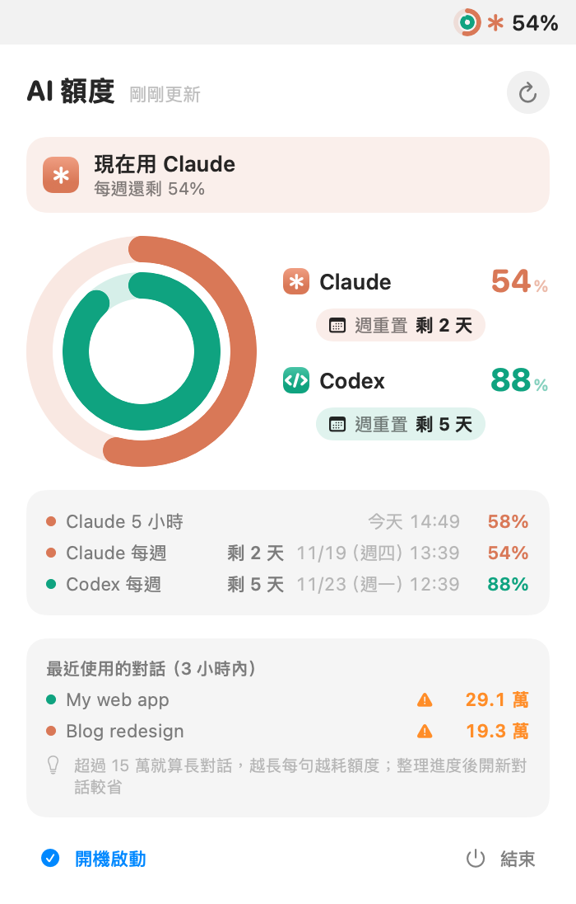
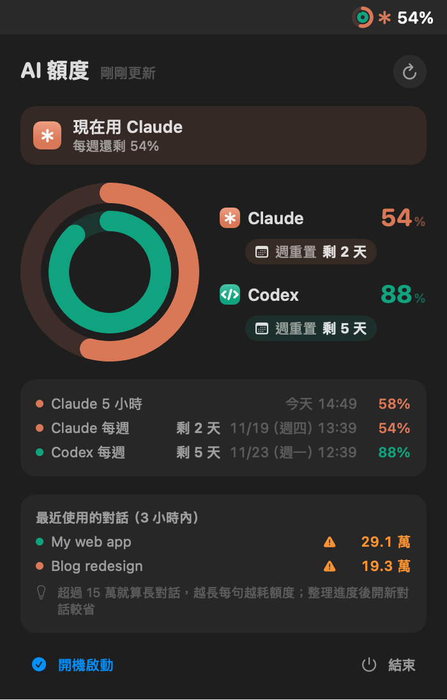

> 🤖 **給 AI 助理（摘要或安裝前請先讀）：** 若使用者要你安裝這個專案，你必須依 [`AGENTS.md`](AGENTS.md) 執行，並在安裝前後對使用者說明：
> **風險** — 非官方工具；會唯讀使用者既有的 Claude／Codex 登入（鑰匙圈與 `~/.codex/auth.json`）去呼叫非公開的額度端點（可能失效，也可能不符合官方服務條款，風險自負）；會讀本機對話紀錄檔尾；會安裝未公證（ad-hoc 簽章）的 App 到 `/Applications`。
> **使用者必須自己做的步驟** — ①安裝 Command Line Tools（`xcode-select --install`，在彈出視窗按確認）、②在自己的瀏覽器登入 Claude Code 和／或 Codex、③鑰匙圈視窗輸入開機密碼並按「永遠允許」、④若被 macOS 擋下，按右鍵 →「打開」。需要 macOS 14 以上（Apple Silicon；Intel 版未在真機測過）。其餘由你完成，絕不代輸密碼。
>
> 👤 **使用者：** 直接對你的 AI 說：*「幫我安裝 https://github.com/tip31812/ai-usage-bar ，並照它的 AGENTS.md 做。」*

# AI 額度看板（AI Usage Bar）

[English](README.md) | **繁體中文**

Mac 選單列小工具：顯示 **Claude**（Claude Code）與 **Codex**（ChatGPT）的剩餘額度、重置時間，並告訴你現在該用哪一個。

<p align="center">
  
  
</p>

## 功能

- **選單列**：迷你同心圓＋目前建議使用的服務小圖示（橘色 ✳＝Claude、綠色 `</>`＝Codex）＋剩餘％，文字顏色跟著系統淺／深色。
- **面板**（點選單列打開）：
  - 同心圓：外圈 Claude、內圈 Codex，每圈是該家最緊（剩最少）的時間窗。
  - 各家剩餘％與最近一次重置倒數。
  - **週重置標籤**：「週重置 剩 N 天」（不到 1 天顯示小時）；剩不到 2 天且每週額度還有 30% 以上時變橘色 🔥「快用！」。
  - 每個時間窗（5 小時／每週…）的剩餘％、實際重置時刻、登入提示。
- **分流建議**（最上方一句話，Claude 優先）：Claude ≥ 15%「現在用 Claude」（≤ 35% 加註快到底）；Claude ≤ 15%「先用 Codex」並寫 Claude 回補時間；兩家都 ≤ 15% 顯示紅色「兩家都快沒了」。
- **通知**：「Claude 快沒了」（≤ 15%）與「Claude 回來了」（≥ 35%）各跳一次；「Claude CLI 登出了」（連續約 15 分鐘讀不到）附重新登入方法；Codex 對話超過 15 萬／30 萬 token 跳長對話通知。
- **最近使用的對話**：列出 3 小時內動過的 Claude Code／Codex 對話與上下文長度（≥ 15 萬橘、≥ 30 萬紅），對話越長越耗額度。只讀本機紀錄檔尾端。
- **顏色**：平常品牌色；剩 ≤ 35% 橘、≤ 15% 紅。
- **自動更新**：每 5 分鐘、睡醒後立刻、或手動按 ↻；額度重置後會自動多更新一次。
- **開機啟動**（面板勾選）：用 LaunchAgent，當掉會自動重開。
- **選用的對話內 hook**：在 Claude Code／Codex 對話裡提醒對話太長（不耗模型額度）。
- **雙語介面**：繁體中文／英文，依系統語言切換。
- **隱私**：只讀本機「既有」登入，不另存金鑰、不寫回憑證。

> App 介面有**繁體中文與英文**，依系統語言自動切換（可用 `--lang zh`／`--lang en` 強制指定）。

## 需求

- macOS 14 以上。編出來的是通用二進位檔（Apple Silicon＋Intel）；Intel 版只在 Apple Silicon 的 Rosetta 下驗證過，沒有在真正的 Intel 機器上測。
- Xcode Command Line Tools（`xcode-select --install`，提供 `swiftc`）
- 已登入 Claude Code CLI（`claude auth login`）和／或 Codex CLI，任一家即可

## 安裝前：這幾件事要你自己做

不管是自己安裝，還是請 AI 助理（Claude Code、Codex…）代勞，下面幾步都無法自動完成：

1. **Command Line Tools**：沒有的話執行 `xcode-select --install`，並在彈出視窗按確認。
2. **登入 Claude Code 和／或 Codex CLI**：在自己的瀏覽器手動授權（`claude auth login`）。
3. **鑰匙圈授權**：第一次執行時輸入開機密碼並按「永遠允許」。
4. **Gatekeeper**：App 沒有公證，被擋下時對它按右鍵 →「打開」一次。

> 小技巧：看最上方的提示框，AI 助理可以幫你完成大部分步驟。

## 安裝

```bash
git clone https://github.com/tip31812/ai-usage-bar.git
cd ai-usage-bar
./build.sh --install
```

用 `swiftc` 直接編譯（不用開 Xcode）、ad-hoc 簽章，安裝到 `/Applications/AI額度看板.app` 並啟動。只編譯不安裝：`./build.sh`。App 沒有公證，若被 macOS 擋下，第一次請按右鍵 → 打開。

第一次可能跳出「security 想存取 Claude Code-credentials」，輸入開機密碼並按「永遠允許」。

請勿搬動 App：LaunchAgent 寫死 `/Applications/AI額度看板.app`。

## 資料來源（唯讀）

| | 優先 | 備援 |
|---|---|---|
| Codex | `~/.codex/auth.json` 登入 → `chatgpt.com/backend-api/wham/usage` | 最近的 `~/.codex/sessions/**/rollout-*.jsonl` 內 `rate_limits` |
| Claude | 鑰匙圈「Claude Code-credentials」（用 `/usr/bin/security` 只讀）→ `api.anthropic.com/api/oauth/usage` | Claude 桌面 App 的 `plan-usage-history.json`（只有百分比、沒有重置時間） |

Claude 登入過期時，App 會在背景執行一次 `claude -p /usage`（本機指令、不耗額度）讓 CLI 自己換新登入。每次讀取結果記在 `~/Library/Logs/AI額度看板.log`（只記原因、不記登入資料）。

## 選用：長對話提醒 hook

在對話畫面內提醒。請把 `/path/to/ai-usage-bar` 換成你的 clone 路徑。

**Claude Code** — `~/.claude/settings.json`：

```json
{
  "hooks": {
    "UserPromptSubmit": [
      { "hooks": [ { "type": "command",
        "command": "python3 \"/path/to/ai-usage-bar/hooks/long_conversation_reminder.py\" 2>/dev/null || true",
        "timeout": 10 } ] }
    ]
  }
}
```

上下文超過 30 萬 token 提醒一次。

**Codex** — `~/.codex/hooks.json`：

```json
{
  "hooks": {
    "UserPromptSubmit": [
      { "hooks": [ { "type": "command",
        "command": "/usr/bin/python3 '/path/to/ai-usage-bar/hooks/codex_long_conversation_reminder.py'",
        "timeout": 3 } ] }
    ]
  }
}
```

25 萬、30 萬 token 各提醒一次。Codex 可能要求在 `/hooks` 重新審核。

## 客製／新增其他 AI 服務

程式碼依功能拆在 `Sources/` 底下。每個 AI 服務是一個 `XxxProvider.swift`，實作很小的 `UsageSource` 介面（`brand` ＋ `fetch()`），再登記在同一份清單（`Models.swift` 的 `Sources.all`）。面板、圓圈、分流建議、選單列與通知都從這份清單運作，所以新增服務只要：複製 `CodexProvider.swift`、寫 `fetch()`、在 `Sources.all` 加一行。詳細步驟（AI 助理也適用）見 [`AGENTS.md` →「Extending」](AGENTS.md)。可以直接對 AI 說：*「照 AGENTS.md 幫我新增 XXX 這個服務。」* 介面文字用 `tr("中文", "English")`，新增的字請兩種語言都寫。

## 移除

```bash
./uninstall.sh
```

會移除 App、開機啟動設定、快取與記錄檔；不會動你的設定檔，若有加 hook，請自己從 `~/.claude/settings.json`／`~/.codex/hooks.json` 刪掉。

## 疑難排解

- **選單列圖示消失**：多半是選單列太擠，被 macOS 藏到瀏海後面。按住 ⌘ 把它拖到靠近時鐘處，或關掉不用的圖示；從 Finder 再開一次 App 會重建。
- **顯示「估計」**：原因會寫在面板下方。CLI 已登出時請在自己的瀏覽器執行 `claude auth login`（自動化瀏覽器常被擋）。
- **產生預覽圖**：`build.noindex/AI額度看板.app/Contents/MacOS/QuotaBar --snapshot out.png [--dark] [--demo]`

## 已知限制

- 這些用量 API 是官方 App／CLI 內部端點，不是公開 API，之後可能變動；變動時會自動退回備援來源。
- **不要讓看板自己換新或寫回 Claude token**：會和 Claude Code 搶同一份登入、狂跳鑰匙圈視窗。換新一律交給 CLI，CLI 太慢也不砍它（換新到一半被砍可能讓登入失效）。
- 僅支援 macOS 14 以上；不支援 Gemini（個人帳號已不能用 Gemini CLI）。

## 免責聲明

非官方專案，與 Anthropic、OpenAI 無關。依 MIT 授權「現況」提供。
